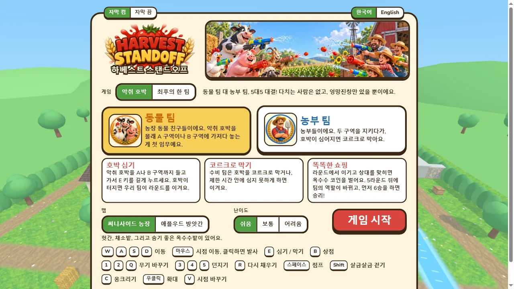
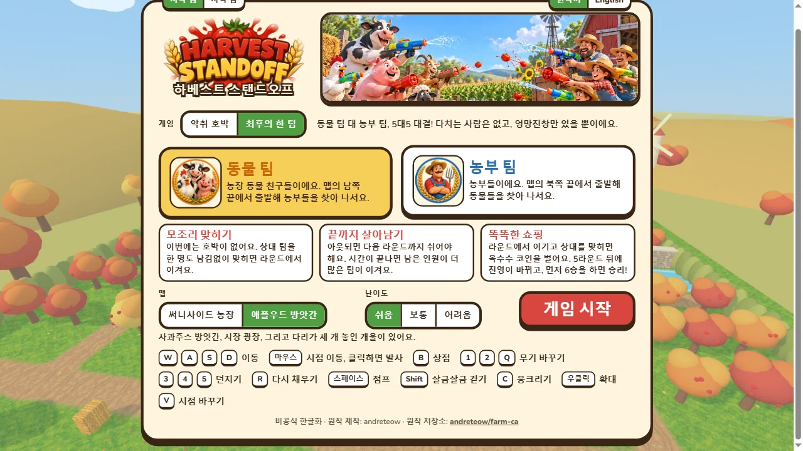
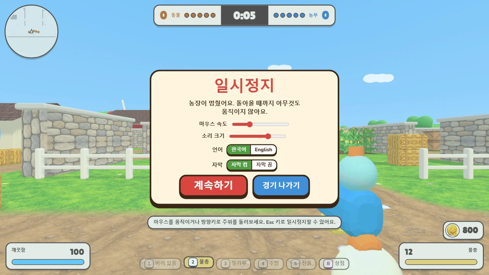
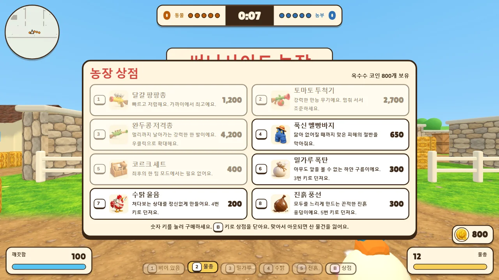
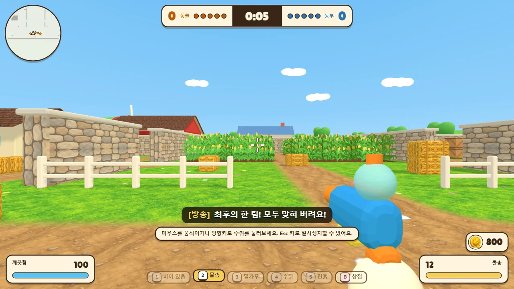
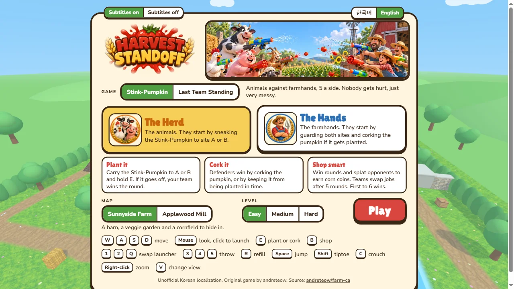

# 하베스트 스탠드오프 한글화 (Harvest Standoff 한국어판)

농장 동물 팀 대 농부 팀, 5대5 1인칭 물총 슈터 **Harvest Standoff**의 비공식 한글화입니다. 다치는 사람은 없고, 엉망진창만 있을 뿐이에요.

- **바로 플레이**: https://sigco3111.github.io/harvest-standoff-ko/ (키보드와 마우스가 있는 컴퓨터의 최신 Chrome / Edge / Firefox / Safari)
- 기본 언어는 한국어이고, 메인 메뉴 오른쪽 위(또는 일시정지 화면)의 **한국어 / English** 버튼으로 바꿀 수 있어요. 선택은 브라우저에 저장돼요.
- 로딩 시 외부 서버(글꼴 CDN, 분석 도구 등)를 부르지 않아요. 글꼴 Lilita One / Nunito 는 저장소 안에 들어 있고, 한글은 시스템 글꼴(Pretendard, Noto Sans KR, Apple SD Gothic Neo, 맑은 고딕)로 표시돼요.

## 스크린샷

실제 서비스(https://sigco3111.github.io/harvest-standoff-ko/)를 1280×720 크기로 찍은 화면이에요.



**한국어 메인 메뉴.** 로고 아래에 한글 제목 '하베스트 스탠드오프'가 겹쳐 보이고, 왼쪽 위에 자막 켬/끔, 오른쪽 위에 한국어/English 버튼이 있어요. 게임 방식(악취 호박 / 최후의 한 팀), 동물 팀·농부 팀 설명, 맵, 난이도, 게임 시작 버튼, 조작 키 안내가 보여요.



**게임 방식·맵 선택.** 같은 메뉴를 아래로 내린 모습으로, 게임 방식 '최후의 한 팀'과 맵 '애플우드 방앗간'을 고른 상태예요. 방식에 따라 설명 카드가 바뀌고, 맨 아래에 '비공식 한글화 · 원작 제작: andreteow · 원작 저장소: andreteow/farm-ca' 줄이 있어요.



**일시정지 화면.** 마우스 속도·소리 크기 조절줄, 언어(한국어 / English)와 자막(켬 / 끔) 전환 버튼, 계속하기·경기 나가기 버튼이 있어요. 뒤로 경기 화면이 흐리게 보여요.



**농장 상점.** 경기 시작 전 대기 시간에 열린 상점이에요. 옥수수 코인 800개를 가진 상태에서 품목 8개(번호 1~8)와 가격, 'B 키로 상점을 닫아요' 안내가 보여요. 살 수 없는 품목은 흐리게 표시돼요.



**경기 화면(최후의 한 팀, 써니사이드 농장).** 위쪽에 점수판과 남은 시간, 왼쪽 위에 미니맵, 아래쪽에 깨끗함(체력)·무기 칸·물총 탄약·코인 표시, 가운데 아래에 한글 자막 줄 `[방송] 최후의 한 팀! 모두 맞혀 버려요!` 가 보여요. 이 장면은 경기 시작 직전 대기 시간(0:05)에 찍었고, 자막 줄은 실제 음성이 나올 때가 아니라 개발 도구에서 자막 표시 함수로 해당 대사를 강제로 띄워 찍었어요.



**영어 메인 메뉴(비교용).** 같은 메뉴를 영어로 바꾼 모습이에요. 로고 아래 한글 제목은 한국어 모드에서만 나와요.

**찍지 못한 화면.** 촬영에 쓴 클라우드 브라우저는 소프트웨어 렌더링이라 3D 장면이 매우 느려서(약 1프레임/초), 경기를 실제로 진행하는 장면(이동·발사, 호박 심기·막기, 킬 피드, 라운드·경기 종료 화면)은 찍지 못했어요. 위 경기 화면은 경기 시작 전 대기 장면 한 컷뿐이에요. 실제 플레이 화면은 직접 플레이하며 찍은 이미지로 채워 넣을 수 있어요.

## 알림 (NOTICE)

- **원작**: Harvest Standoff — 제작자 [andreteow](https://github.com/andreteow)
- **원작 저장소**: https://github.com/andreteow/farm-ca (원작 사이트: https://harvest-standoff.vercel.app/)
- **한글화 기준 커밋**: `05c9c5f76f01bd65d0576388edb3ff4fcad40488` ("Add a second game mode: Last Team Standing")
- 이 저장소는 **비공식 한글화**이며 원작자와 아무 관련이 없고, 원작자의 승인을 받은 것이 아니에요.
- 한글화 시점에 원작 저장소에는 **라이선스 파일이 없었어요.** 그래서 이 저장소는 어떤 라이선스도 주장하지 않고 LICENSE 파일도 넣지 않았어요. 게임의 코드·그림·소리에 대한 권리는 모두 원작자에게 있어요.
- 원작자에게 공로(크레딧)를 밝혔고, **권리자가 요청하면 이 한글화는 즉시 내리겠습니다.** 문의는 이 저장소의 Issues 로 남겨 주세요.

## 바뀐 점

- 새 언어 시스템: `src/i18n.js` (`t('키')` 조회, 언어 선택을 `localStorage` 의 `hs-lang` 에 저장), 사전 `src/lang-ko.js`, `src/lang-en.js`
- 메인 메뉴·게임 방식·맵·난이도 선택, 키 안내, 일시정지, 경기 종료, 라운드 배너, HUD(점수·체력·무기·코인·상점·상태 표시·안내 문구), 킬 피드, 캐릭터 이름까지 한국어로 번역 (영어도 그대로 선택 가능)
- 한글 글꼴 목록 추가와 줄바꿈(`word-break: keep-all`), 글줄 높이 조정 (`src/page.html`)
- 메인 메뉴 아래쪽 크레딧 줄과 언어 전환 버튼 추가
- `build.mjs`: 결과물을 저장소 맨 위(`index.html`, `vendor/`, `assets/audio.mp3`)에 만들도록 바꿔 GitHub Pages(main / root)에서 바로 서비스해요. 원래 방식은 `node build.mjs --out=dist`
- `package.json` / `package-lock.json`: 원작의 자동 기본값 `ISC` 를 `UNLICENSED` 로 바꿨어요. (이 저장소는 어떤 라이선스도 주장하지 않아요.)
- **한글 자막 (K2)**: 영어 음성 58개(해설 16, 농부 무전 22, 동물 무전 20)를 재생할 때 화면 아래 가운데에 `[방송]` / `[농부 무전]` / `[동물 무전]` 자막이 떠요. 영어 모드에서는 영어 원문이 나와요. 일시정지 화면과 메인 메뉴의 **자막 켬 / 끔** 버튼으로 바꾸고, 기본은 켬이에요(`localStorage` 의 `hs-subs`). 소리 파일은 손대지 않았어요. 코드: `src/subtitles.js`, 대사: `src/lang-*.js` 의 `vo.*` 키
- **일시정지 화면에서도 언어 전환** 가능
- **로고 아래 한글 제목**: 로고 이미지(`assets/ui/logo.jpg`, 원작 그대로)는 그대로 두고, 한국어 모드에서 그 아래에 'HTML 글자'로 '하베스트 스탠드오프'를 겹쳐 보여줘요
- 코드에 남아 있던 영어 문구(`src/config.js`, `src/world.js`, `src/page.html` 기본값)를 정리해 모든 문구를 언어 파일에서 가져오고, 코인 숫자 표기가 선택한 언어(ko-KR / en-US)를 따라요
- 용어·말투(해요체) 일관성 점검과 몇 가지 문구 다듬기 (프롬프트 문장화, '지도' → '미니맵')
- **README 스크린샷**: `docs/screenshots/` 에 실제 서비스 화면 6장(WebP)을 넣고, README 에 '스크린샷' 절을 추가
- 아직 영어 그대로인 것: 음성(소리) 자체, 로고 이미지 속 영어 글자(자막/한글 제목으로 보완). 동물 울음소리 5개는 말이 아니라서 자막이 없어요

## 직접 빌드하기

```bash
npm install
node build.mjs
```

원작 저장소의 `assets/audio` 폴더(효과음 원본 mp3)를 같은 자리에 복사해 두어야 해요. `index.html` 이 새로 만들어져요. (`three` 는 `npm install` 로 받아 `vendor/three.min.js` 로 복사돼요.)

작업 메모와 남은 일은 [NOTES.md](NOTES.md) 에 있어요.
